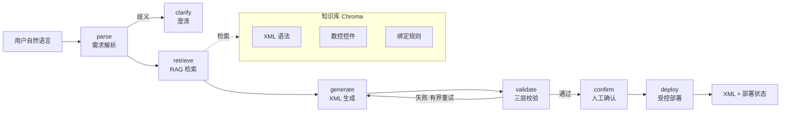

<div align="center">

# 数控 XML 界面生成与自动部署 AI Agent

**让操作工用一句自然语言，生成可部署的工业数控界面 XML**

[](https://www.python.org/)
[](LICENSE)
[](https://github.com/shizhihao/nc-xml-agent/actions/workflows/ci.yml)

`LangGraph` · `LangChain` · `MCP` · `Chroma` · `Qwen2.5` · `PEFT/LoRA` · `FastAPI` · `asyncio`

</div>

---

## 项目概述

数控机床的操作界面由**工业 XML** 配置而成。传统方式下，工程师需要手写数百行 XML 并掌握复杂的变量绑定规则，效率低且易出错。

本项目构建了一个 **AI Agent**，让操作工用一句自然语言（如「顶部显示主轴转速，左侧放一个启动按钮」）即可自动生成**合法、可部署**的 XML 界面。核心挑战在于：**大模型的输出是不确定的，而工业场景要求零容错**。项目通过「生成—校验—回炉」的闭环，把不确定性关进确定性的工程框架。

> **说明**：本项目为实习项目（中科院沈阳高精数控）的**面试演示重建版**，非原始源码。数控硬件底层部署与前端页面不属于本人工作，代码中仅保留占位。

## 技术栈

| 层 | 技术 | 解决什么问题 |
|---|---|---|
| 基座模型 | Qwen2.5 + PEFT/LoRA | 结构敏感的 XML 生成 |
| 结构化输出 | Pydantic + JSON Schema | 让下游稳定消费模型输出 |
| 知识注入 | Chroma + Embedding (RAG) | 注入私有、会变的 XML 规则 |
| 工具执行 | Tool Calling + MCP | 安全地改变外部世界 |
| 状态编排 | LangGraph (StateGraph) | 显式化控制流与有界重试 |
| 服务后端 | FastAPI + asyncio | 高并发异步服务 |

## 架构



完整链路：`parse → retrieve → generate → validate → confirm → deploy`，校验失败回炉（有界重试），部署前强制人工确认（human-in-the-loop）。

## 快速开始

### 环境要求

- Python 3.10+

### 1. 安装依赖

```bash
git clone https://github.com/shizhihao/nc-xml-agent.git
cd nc-xml-agent
pip install -e ".[dev]"     # 核心依赖 + 开发/测试依赖
```

> 默认 `mock` 模式**无需 API key / GPU / Chroma**，用降级实现跑通完整链路。

### 2. 运行演示

```bash
python scripts/demo_run.py
```

输出：需求解析 → RAG 召回 → 生成的 XML → 校验结果 → 部署状态。

### 3. 启动 HTTP 服务

```bash
uvicorn app.api.main:app --reload
```

```bash
# 健康检查
curl http://127.0.0.1:8000/health

# 核心接口
curl -X POST http://127.0.0.1:8000/generate \
  -H "Content-Type: application/json" \
  -d '{"requirement":"顶部显示主轴转速，左侧放启动按钮"}'
```

### 4. 运行测试

```bash
pytest                 # 24 个单元测试
ruff check app scripts tests   # 代码风格检查
```

## 目录结构

```
nc-xml-agent/
├── app/
│   ├── api/main.py          # FastAPI 异步后端
│   ├── graph/agent_graph.py # LangGraph 状态编排（核心）
│   ├── tools/deploy.py      # Tool Calling + MCP + 受控部署
│   ├── rag/vector_store.py  # Chroma 向量库 + Embedding + 检索
│   ├── llm/client.py        # Qwen2.5 封装 + 结构化输出 + 重试
│   ├── llm/lora.py          # PEFT + 结构敏感 LoRA
│   ├── xml_gen/             # XML 生成 + 三层校验
│   └── core/                # 配置 + Pydantic 模型
├── data/knowledge/          # RAG 知识库（语法/控件/绑定规则）
├── tests/                   # pytest 单元测试
├── scripts/demo_run.py      # 演示脚本
├── docs/                    # 面试讲解材料
└── .github/workflows/ci.yml # CI（pytest + ruff）
```

## 核心设计决策

### 1. 结构敏感 LoRA（本项目最有区分度的技术点）

标准 LoRA 对所有 token 一视同仁，但工业 XML 中 `<`、`>`、属性名等**结构符号错一个就整段失效**。本项目在训练 loss 上按 token 类型重加权，让模型对结构符号「更敏感」，把「结构正确」这个业务约束直接编码进训练目标。

### 2. 三层 XML 校验

把 LLM 的不确定输出关进确定性框架：

1. **良构性** — XML 标签闭合、引号、非法字符
2. **Schema** — 根节点、唯一 id、type 属性
3. **业务规则** — 只读变量不可写入、input 必须声明取值范围

### 3. 有界自主（Bounded Autonomy）

「校验失败 → 回炉重生成」不是 `while True`，而是由 `retry_count` + LangGraph 的 `recursion_limit` 双重约束，超限强制终止或上升人工。

### 4. human-in-the-loop 部署

LLM 生成的 XML 即使通过自动校验，仍可能有语义错误（绑错变量）。部署前必须人工确认，配合 Tool Calling 的「决策执行分离」保证安全。

## 为什么选这些技术

| 选择 | 理由 | 替代方案 |
|---|---|---|
| **Chroma** vs FAISS | 知识会频繁更新，需要增量 upsert + 持久化 + 元数据过滤 | 大规模静态库选 FAISS |
| **Qwen2.5** vs GPT/Llama | 中文强、开源可私有化（工业数据不出内网）、可微调 | 数据可出境时可用闭源 API |
| **MCP** vs 硬编码工具 | 工具服务化，增删改不重发版（配置迭代） | 工具稳定时可写死 |
| **LangGraph** vs 手写 if/else | 控制流显式、可测试、可 checkpoint | 线性无分支用 LCEL 即可 |

## 个人贡献边界

**本人独立负责**：FastAPI + asyncio 后端、LangGraph 状态编排、LCEL/结构化输出/Tool Calling、MCP 工具封装、Chroma RAG、Qwen2.5 + LoRA 微调、XML 生成与校验。

**非本人工作（仅占位）**：数控硬件底层部署协议、前端页面。

## 许可证

[MIT](LICENSE)
